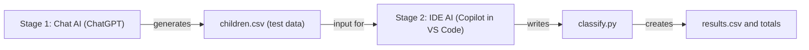

# Multi-Stage AI Workflow: Child Nutrition Screening

## Problem
Health workers screen children aged 6–59 months using MUAC (mid-upper arm
circumference) and a check for oedema. Classifying each child by hand is slow
and easy to get wrong. This workflow uses two AI tools of different UX types
to create test data and a program that classifies every child automatically.

## AI tools used (two UX types)
| Stage | UX type | Tool I used | Can be replaced by |
|-------|---------|-------------|--------------------|
| 1 | Chat-based AI | ChatGPT | Gemini, Claude, Copilot chat |
| 2 | IDE-based AI | GitHub Copilot in VS Code | Cursor, Gemini Code Assist |

## Workflow diagram


## Step-by-step
1. **Chat AI creates the data.** I asked ChatGPT for a CSV of 15 children
   with the columns child_id, name, sex, age_months, muac_mm and oedema
   (prompts below).
2. **I saved the output** as `children.csv` in this folder.
3. **IDE AI writes the code.** I gave Copilot in VS Code a prompt that uses
   `children.csv` as input. It created `classify.py`.
4. **I checked the code** to make sure it uses simple Python (one function,
   a for loop, if/elif/else, lists) and the correct rules.
5. **I ran the program** with the Run button. It printed every child's
   status and the totals, and saved `results.csv`.

## Classification rules (CMAM)
| Condition | Status |
|-----------|--------|
| Oedema = yes (any MUAC) | Severe (SAM) |
| MUAC < 115 mm | Severe (SAM) |
| MUAC 115–124 mm | Moderate (MAM) |
| MUAC ≥ 125 mm | Normal |

## Results
Severe: 7 · Moderate: 3 · Normal: 5

Test cases worth noting:
- Jean, MUAC exactly 115 → Moderate (the boundary works)
- Diane, MUAC 125 with oedema → Severe (the oedema rule comes first)

## Prompts used
**Stage 1 (Chat AI):**
```
Create a small test dataset in CSV format about children checked for malnutrition.
Columns: child_id, name, sex, age_months, muac_mm
Rules:
- 15 rows
- child_id goes from 1 to 15
- sex is M or F
- age_months is a whole number between 6 and 59
- muac_mm is a whole number between 100 and 140
- include at least one child with muac_mm exactly 115 and one with exactly 125
Give me ONLY the CSV text, with no explanation.
```
Follow-up:
```
Add one more column at the end called oedema, with the value yes or no.
Rules:
- most children have no
- exactly 3 children have yes
- at least one child with yes must have muac_mm of 125 or more
Keep all other values the same. Give me ONLY the CSV text, with no explanation.
```

**Stage 2 (IDE AI):**
```
Read the file children.csv in this folder and create a Python file called classify.py.
The program must:
1. Open children.csv and read it line by line (do not use pandas, use only basic Python).
2. For each child, decide the nutrition status with these rules, in this order:
   - if oedema is "yes" -> "Severe (SAM)"
   - else if muac_mm is less than 115 -> "Severe (SAM)"
   - else if muac_mm is less than 125 -> "Moderate (MAM)"
   - else -> "Normal"
3. Print one line per child: name, muac_mm, oedema, status.
4. At the end, print how many children are Severe, Moderate and Normal.
5. Save the results in a new file called results.csv with the columns: child_id, name, muac_mm, oedema, status.
Keep the code simple for a beginner: use one function called classify_child, a for loop, if/elif/else and lists. Add short comments explaining each part.
```

## Why it is tool-independent
The prompts are plain text and the data is a plain CSV, so any chat AI and
any IDE AI can do the same stages. The final program uses only Python's
built-in `csv` module, so it runs without any AI tool and without installing
anything.

## How it saves time
Classifying a list of children by hand means checking each one against the
rules. With this workflow, a new list only needs to be saved as
`children.csv`, and one click on Run classifies everyone, counts the totals
and saves the results.

## How to run
```
python classify.py
```

## Note
All data is made up (synthetic) for testing. No real children's data is used.